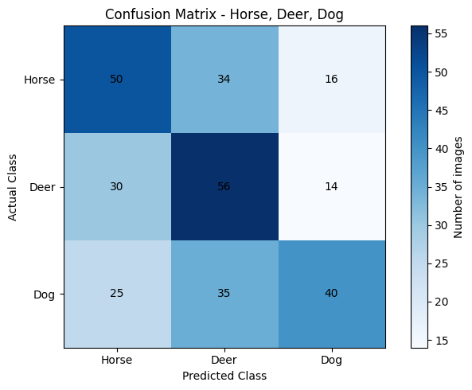
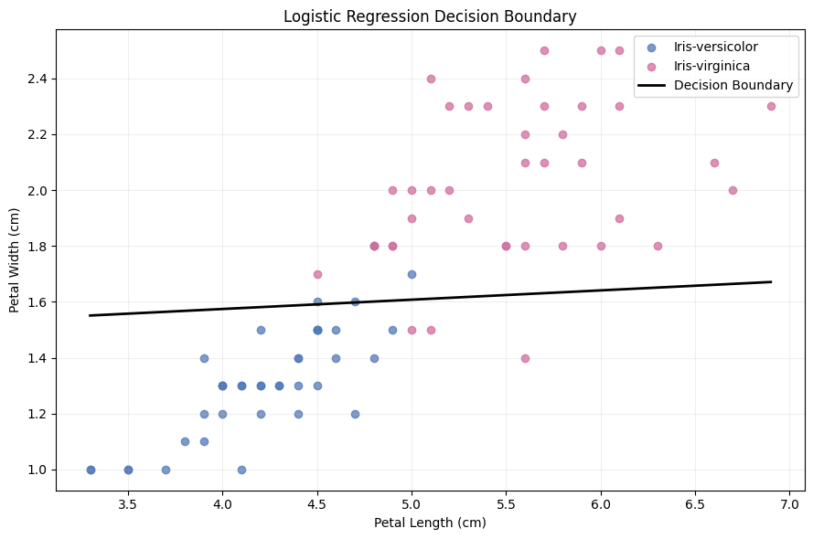
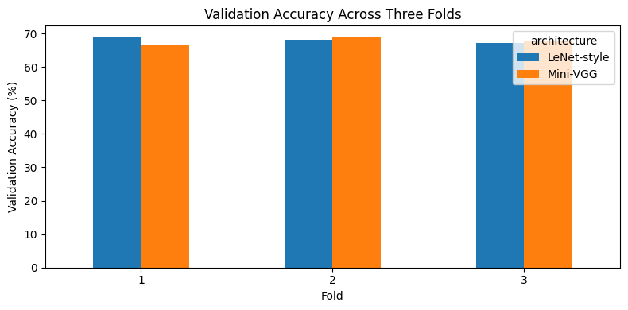
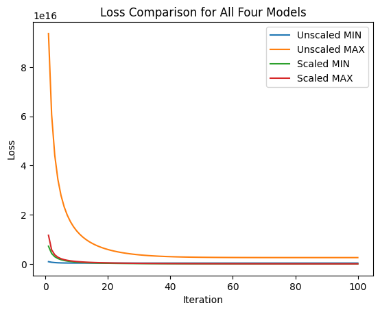

# Machine Learning Experiments

**From-scratch classifiers, CNN architecture comparisons, and custom-loss optimization in Python.**

A collection of four documented experiments exploring not only *what* a model predicts, but *how* modeling choices, data representation, and evaluation affect its results. The work ranges from a NumPy implementation of logistic regression and a manual Gaussian Naive Bayes classifier to convolutional neural networks in PyTorch and regression with an analytically derived custom loss.

> **Result provenance:** All performance figures below were transcribed from saved outputs in the original notebooks. The notebooks have **not** been rerun in a clean environment as part of this portfolio preparation. Treat these as reported experimental results, not independently reproduced benchmarks.

## Experiments at a glance

| Experiment | Approach | Dataset and evaluation | Reported result |
| --- | --- | --- | --- |
| [Gaussian Naive Bayes](classification/gaussian-naive-bayes-cifar10.ipynb) | Class-conditional Gaussian distributions estimated manually; log-likelihood prediction | CIFAR-10 **horse/deer/dog** subset; 15,000 train / 300 test images | **48.67%** test accuracy (146/300) |
| [Logistic Regression from Scratch](classification/logistic-regression-iris.ipynb) | NumPy sigmoid, binary cross-entropy, analytic gradients and gradient descent | Iris **versicolor/virginica**; 80 train / 20 test samples | **95.00%** test accuracy (19/20) |
| [LeNet-style vs Mini-VGG](deep-learning/lenet-vs-mini-vgg-cifar10.ipynb) | Two PyTorch CNNs; stratified 3-fold validation and ablation-style experiments | Full 10-class CIFAR-10; 50,000 train / 10,000 held-out test images | **68.65%** LeNet-style; **69.24%** Mini-VGG test accuracy |
| [Ford Ranger Custom Loss](regression/ford-custom-loss.ipynb) | Manual linear regression gradients for squared + quartic error; feature scaling and decaying learning rate | Year-to-price series with 19 observations; no held-out test set | Lower **training loss** after scaling; illustrative 2026 range **$27,646.67–$49,982.29** |

## Technical highlights

### 1. Gaussian Naive Bayes: similar animals, different pixels

The notebook selects 5,000 training and 100 test images per class from CIFAR-10 (horse, deer, dog), flattens each 32 × 32 × 3 RGB image into **3,072 normalized pixel features**, and independently estimates each class's feature-wise means and variances. Classification uses Gaussian **log-likelihoods**, class priors and a small variance-smoothing term (`1e-6`) for numerical stability.

- **Results:** 146/300 correct; horse 50%, deer 56%, dog 40%.
- **Learning:** Pixel dependencies, object shape and spatial relationships are not represented by the Naive Bayes independence assumption, limiting performance on natural images.



### 2. Logistic regression: understanding the training loop

A binary logistic regression implementation using **NumPy rather than a library classifier**. The notebook chooses petal length and width, creates a balanced 80/20 train/test split using seed 42, and optimizes **binary cross-entropy** with manually computed gradients for **1,000 epochs** at a **0.1** learning rate.

- **Training accuracy:** 91.25%; final reported training loss: 0.3582 (initial: 0.6931).
- **Held-out test accuracy:** **95% (19/20)**. Because the test set is small, this figure should not be interpreted as a precise population-level estimate.



### 3. CNN comparison: LeNet-style vs Mini-VGG

Two PyTorch architectures are trained on identical stratified **3-fold splits** of the CIFAR-10 training set. Each fold uses **8 epochs**, **batch size 128**, **SGD with momentum**, cross-entropy loss, and no data augmentation. The best validation checkpoint for each architecture is evaluated on the separate 10,000-image test set.

| Measurement | LeNet-style | Mini-VGG |
| --- | ---: | ---: |
| Mean 3-fold validation accuracy | 68.07% | 67.78% |
| Best selected-fold validation accuracy | 68.82% | 68.87% |
| Held-out test accuracy | **68.65%** | **69.24%** |
| Trainable parameters | 47,530 | 50,138 |

The notebook also explores Mini-VGG width (0.5×, 1×, 2×), dropout (0.0, 0.2, 0.4), and SGD versus Adam. In one follow-up validation split, the **2× width** version reached **72.07% validation accuracy**. These are exploratory validation results, **not additional test-set scores**.

**Evaluation caveat:** The notebook chose Mini-VGG for these follow-up experiments *after comparing baseline test accuracies*. Consequently the later comparisons are exploratory rather than a fully untouched-test-set hyperparameter selection protocol. The main test difference is only **0.59 percentage points**, insufficient to claim general architectural superiority.



### 4. Ford Ranger regression: optimization under a custom loss

This **collaborative** experiment fits independent minimum- and maximum-price linear models to **19 year-level observations** attributed in the notebook to Cars.com. Its custom objective gives large errors much greater weight:

\[
J(\theta_0,\theta_1)=\frac{1}{m}\sum_{i=1}^{m}\left(e_i^2+0.1e_i^4\right),\qquad e_i=\theta_0+\theta_1 x_i-y_i
\]

Four 100-iteration training configurations compare original calendar-year inputs with **standardized years and a decaying learning rate**. The scaled models report lower **training** losses. The notebook estimates values for 2012–2018 (years missing from its U.S. Ranger series) and a 2026 minimum–maximum price range of **$27,646.67–$49,982.29**.

This is a historical, illustrative regression exercise, **not a current vehicle valuation or verified 2026 MSRP**. Only model year is used as a feature; there is no held-out evaluation, no inflation correction, and no independent verification of the source price table within this repository.



## Repository structure

```text
machine-learning-experiments/
├── classification/
│   ├── gaussian-naive-bayes-cifar10.ipynb
│   └── logistic-regression-iris.ipynb
├── deep-learning/
│   └── lenet-vs-mini-vgg-cifar10.ipynb
├── regression/
│   └── ford-custom-loss.ipynb
├── assets/                     # figures extracted from saved notebook outputs
├── docs/
│   ├── EXPERIMENTS.md          # expanded methodologies and limitations
│   └── REPRODUCIBILITY.md     # dataset, execution and environment notes
├── scripts/
│   └── validate_notebooks.py  # notebook JSON/structure validation only
├── requirements.txt
├── .gitignore
└── README.md
```

## Getting started

These instructions describe a **proposed local environment**, not a verified clean-room reproduction. The dependency list is intentionally unpinned because the original notebooks did not record an exact lockfile.

```bash
python3 -m venv .venv
source .venv/bin/activate                 # macOS / Linux
python -m pip install --upgrade pip
python -m pip install -r requirements.txt
python scripts/validate_notebooks.py     # structure check; does not run models
jupyter lab
```

Open a notebook in JupyterLab and run its cells in order. First-time dataset downloads need network access; the CNN experiment additionally benefits from an available GPU. See [Reproducibility Notes](docs/REPRODUCIBILITY.md) for dataset sources, Mac considerations and execution caveats. CNN runs may require significant compute and dependency/platform adjustments.

## Methodology and limitations

- **No benchmark inflation:** Train, validation and test results are labeled separately. Saved notebook output does not prove clean-room reproducibility.
- **Small sample sizes:** The Gaussian NB evaluation uses 300 selected images; the Iris experiment tests on only 20 examples.
- **Selection bias:** The CNN follow-up architecture was chosen after observing test outcomes; follow-up experiments should not be presented as independently held-out performance.
- **No generalization estimate for the Ford experiment:** It reports training losses and predictions without a held-out set.
- **Environment:** Library versions were not recorded in the original notebooks, and exact CPU/GPU reproducibility has not been verified.

More detail: [Experiment Methods and Results](docs/EXPERIMENTS.md).

## Attribution and scope

The Gaussian Naive Bayes, logistic regression and CNN notebooks identify **Berkay Aydin** as their author. The Ford custom-loss notebook identifies **Berkay Aydin and Elif Kanik** as collaborators. Their individual contributions to that joint work are **not further subdivided here**, pending confirmation. Academic course material and datasets retain their respective ownership; review course publication requirements before making the repository public.

Dataset and educational references: [UCI Iris](https://archive.ics.uci.edu/dataset/53/iris), [CIFAR-10](https://www.cs.toronto.edu/~kriz/cifar.html), [PyTorch CIFAR-10 tutorial](https://pytorch.org/tutorials/beginner/blitz/cifar10_tutorial.html). The Ford pricing source is identified as Cars.com in the source notebook but was not independently checked here.
